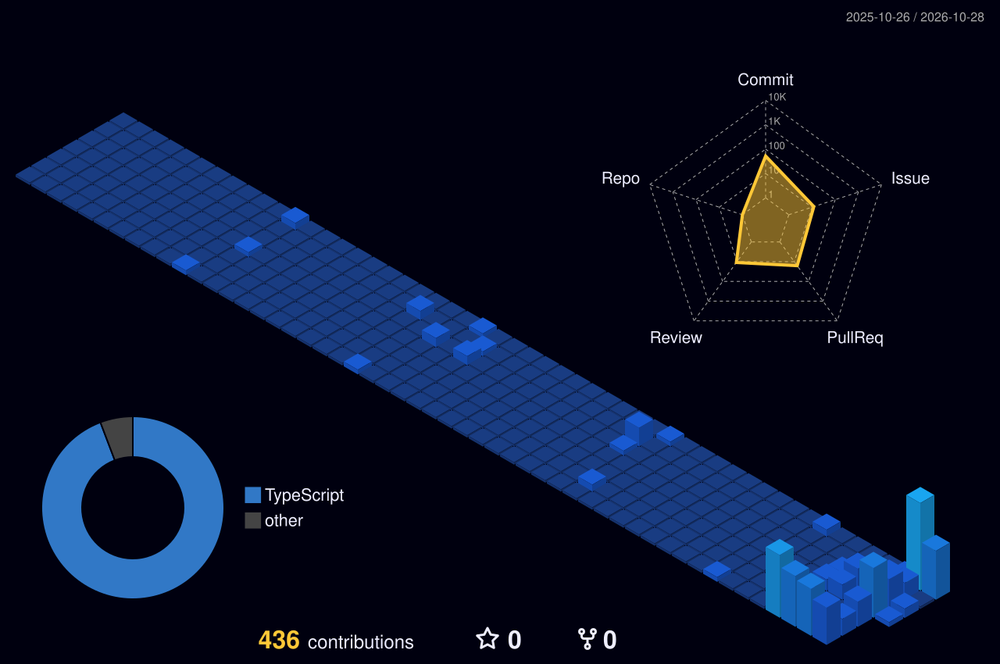

<!-- Typograssy: scrolling HelloWorld -->

 

<h2>Hi there! 👋</h2>

<strong>藤岡楽空 / Gaku Fujioka</strong>

University Student @ UEC · Interested in Frontend Development

 

<h3>💻 Languages &amp; Frameworks</h3>

<h3>🛠 Tools &amp; Services</h3>

<h3>🌱 Currently Learning</h3>

  

<h2>🌱 Contribution Graph</h2>

<!-- Generated by GitHub Actions -->

  

<h2>🎧 Recently Played</h2>

  

<h3>Thanks for stopping by! 🐾</h3>

